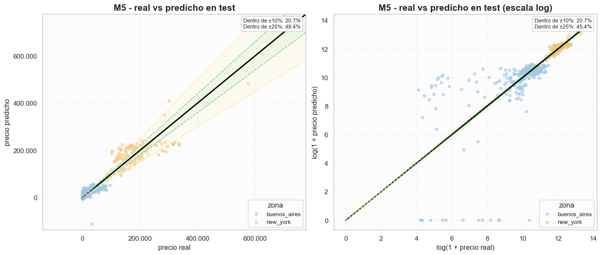

# Predicción de precios de viviendas · Regresión con NumPy

Trabajo práctico individual de **I302 — Aprendizaje Automático y Aprendizaje Profundo**,
Universidad de San Andrés, primer semestre de 2026.

**Autor:** Tomás González.  
Implementación propia de regresión lineal, Ridge y Lasso, con análisis exploratorio,
preprocesamiento, ingeniería de características y comparación de modelos.



## Documentación

- [Consigna original](docs/consigna.pdf).
- [Notebook de la entrega](notebook/Entrega_TP1.ipynb): desarrollo, gráficos, métricas y conclusiones.
- [README original](docs/README_entrega_original.md): explicación de los módulos y
  declaración original sobre el uso de IA para presentación y gráficos.

## Estructura

| Ruta | Contenido |
| --- | --- |
| `src/models.py` | Clase `RegresionLineal`: pseudoinversa, descenso por gradiente y regularización. |
| `src/metrics.py` | ECM, MAE, RMSE y R². |
| `src/data_splitting.py` | Separación train/validation y generación de folds. |
| `src/preprocessing.py` | Limpieza, imputación, escalado y características derivadas. |
| `src/utils.py` | Entrenamiento, evaluación, validación cruzada y curvas de aprendizaje. |
| `src/visualization.py` | Gráficos del análisis y de los resultados. |
| `data/raw/` | Datos originales: 1.600 registros de desarrollo y 400 de test. |
| `data/processed/` | CSV intermedios conservados de la entrega. |

Los CSV de la consigna coinciden byte a byte con los de `data/raw/`; se incluyen
una sola vez. El ZIP original contiene seis archivos `.pyc` que se omitieron por
ser cachés regenerables de Python.

## Recorrido del trabajo

1. Explorar valores faltantes, distribuciones y relaciones entre variables.
2. Construir el dataset base, convertir unidades y separar desarrollo en train/validation 80/20.
3. Implementar regresión por pseudoinversa y descenso por gradiente; comprobarla
   con una y varias características.
4. Comparar M1, M2 y M3, incorporando información de superficie, pileta y otras variables.
5. Construir M4 y M5 mediante ingeniería de características y estudiar el sobreajuste.
6. Evaluar Ridge y Lasso, seleccionar penalizaciones con validación cruzada y definir M6.
7. Comparar curvas de aprendizaje, seleccionar el modelo con validation y evaluar en test.

Los modelos se implementan con NumPy, sin usar scikit-learn. Pandas se utiliza para
manejar tablas y Matplotlib/Seaborn para graficar.

## Resultados guardados

La ejecución original selecciona **M5**. El notebook reporta aproximadamente
**31.520 USD de RMSE** y **0,911 de R²** en validation. Tras el reentrenamiento final
sobre desarrollo, la tabla guardada de test muestra:

| Métrica | Valor |
| --- | ---: |
| MAE | 19.723,0035 USD |
| RMSE | 29.975,8459 USD |
| R² | 0,8933 |

Son resultados de las salidas originales, no de un reentrenamiento realizado al
publicar. Después de la limpieza, la entrega trabaja con 1.488 registros de
desarrollo y 372 de test; el split de desarrollo produce 1.190 de train y 298 de validation.

## Ejecutar

El notebook registra **Python 3.12.2**. Las versiones originales de las bibliotecas
no quedaron registradas; `requirements.txt` enumera las dependencias identificadas.

Desde la raíz del repositorio:

```sh
python -m venv .venv
```

Activar el entorno:

```powershell
# Windows PowerShell
.\.venv\Scripts\Activate.ps1
```

```sh
# macOS / Linux
source .venv/bin/activate
```

Instalar dependencias y abrir JupyterLab en el directorio del notebook:

```sh
python -m pip install -r requirements.txt
cd notebook
python -m jupyterlab
```

Abrir `Entrega_TP1.ipynb`, seleccionar el entorno instalado y ejecutar las celdas
en orden. **El directorio de trabajo del kernel debe ser `notebook/`**: el código
original busca `src/` y `data/` a partir de su carpeta padre mediante `Path("..")`.

La ejecución puede tardar por las grillas de regularización, la validación cruzada
y las curvas de aprendizaje. También reescribe los CSV intermedios de `data/processed/`.
Las salidas guardadas permiten revisar la entrega sin volver a entrenar.

## Conservación y verificación

El código, notebook, README original y CSV se preservaron sin modificaciones.
La figura de este README procede de una salida ya guardada del notebook.
Se agregaron documentación, dependencias y un
[registro de procedencia con hashes SHA-256](docs/procedencia.json).

Se verificaron la sintaxis del código y las celdas, la coincidencia de los datos
con la consigna y comprobaciones acotadas de regresión sintética, métricas y separación
de conjuntos. El [registro de verificación](docs/verificacion_basica.json) detalla
qué se comprobó y las versiones utilizadas. No se ejecutó el notebook completo
ni se reentrenaron los modelos sobre los datos inmobiliarios.

La consigna y los datos provienen de la cátedra. Se conserva la declaración de
autoría del material entregado; no se añade una licencia sobre estos materiales
ni se reconstruye un historial de desarrollo anterior.
